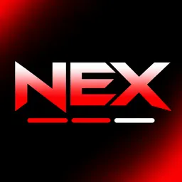

# NEX

  
  
<strong>An independent Android Nintendo Switch emulator project built from Eden's open-source code.</strong>

  
<a href="https://github.com/XDavi196/NEX/releases/tag/v0.1.0-alpha.228">Get the latest verified experimental APK</a>

NEX is a community project for Android phones and tablets. It started from the Eden codebase, and the work here is about giving that foundation a separate identity, maintaining an Android-focused build, and developing a first-party NEX integration with Nextendo Network.

The project is still young. Some parts are already in the app, some are being tested, and some of the online work still needs to be built. This README aims to show what is available today and what is still planned, without promising features that are not ready.

> **Please read before installing:** NEX is an experimental preview. The latest published and verified APK is **v0.1.0-alpha.228** (Actions run #228, source commit `1088b516`); native/Kotlin tests, optimized APK build, artifact upload and prerelease publication passed. It includes the account eligibility diagnostic. A device test has confirmed that the Nextendo account-admission check passes for the linked NEX account. This does not verify BAAS/LoginEx, secure PRUDP or SMM2 matchmaking; NEX is not multiplayer-ready.

## What NEX is

NEX is a **community fork of Eden**. Eden's source code is the starting point for the emulator. NEX has its own Android application identity, its own changes, and its own Nextendo client registration. It is developed separately from upstream Eden.

The current source base is Eden `v0.2.0-rc1`, pinned to commit `8e373eb714aa01117ec885680477501cdb572112`.

- **Platform:** Android phones and tablets.
- **Application name:** NEX.
- **Android application ID:** `com.nex.nx`.
- **Nextendo OAuth callback:** `com.nex.nx://oauth/callback`.
- **Nextendo public Client ID:** `nxc_yAdR-14bOEq7`.
- **Build variant:** Eden Android Optimized, customized for NEX.

NEX remains based on the pinned Eden Optimized source. Its Games header, friends entry point and per-title status badges adapt Den2's GPL-3.0 Android UI work, with attribution in the integration notes. The NEX application identity, OAuth Client ID, PKCE flow, session storage and network implementation remain NEX-owned; no Den2 client ID, token, private credential, signing key or attestation material is reused.

## Nextendo Network in NEX

The goal is to let NEX players connect their own Nextendo account, view their profile, and see their friends from inside the emulator.

NEX uses its **own public Client ID** from the Nextendo Developer Portal. The Android sign-in flow uses OAuth 2.0 Authorization Code with PKCE (S256). The app creates a fresh PKCE verifier and challenge for each login; no client secret is embedded in the APK.

The current requested scopes are:

`identity friends presence profil game.matchmaking emulator.status`

The first in-game validation target is **Super Mario Maker 2**. Nextendo publishes a dedicated SMM2 NEX server, but NEX still needs the title's confirmed client endpoint, authentication and network configuration before it can connect. The account screen and a successful APK build do not mean SMM2 multiplayer is ready.

### Where to find it

The Games screen uses a compact friends/account icon in the top toolbar, following Den2's navigation pattern. Its menu opens the NEX Friends screen, NEX account panel or NEX network settings. The game library displays public per-title online counts when Nextendo publishes them, plus a version warning for SMM2 when the installed version differs from 3.0.3.

### Connecting your account

1. Open NEX and tap the friends/account icon on the right side of the Games header.
2. NEX opens the Nextendo authorization page in your browser.
3. Sign in on Nextendo and approve the permissions shown there.
4. The browser returns to NEX through `com.nex.nx://oauth/callback`.
5. After the connection completes, open the same toolbar menu and choose **Conta Nextendo** or **Amigos**.

The account panel can show the username, Friend Code, and PID when those details are available. Choose **Friends** to request the friend list.

### Friends, presence and network stats

The account panel shows the signed-in player's identity, Friend Code, PID, granted OAuth scopes, game-token readiness and the latest presence diagnostic. The Friends screen reads the OAuth-scoped `/api/oauth/userinfo` response and does not invent missing presence, incoming requests, NSA or Switch account UUID values. The richer game-friend endpoint is requested separately with the `nx2.` token; only entries with an explicit NSA can be passed to the game-facing friend cache.

The account panel also reads the public `/api/stats` endpoint and displays aggregate counts for online players, registered accounts and online games. This request is optional and has a short timeout; a stats outage does not block account sign-in.

### Chat privado entre amigos (experimental)

Ao tocar em um amigo aceito na lista do NEX, o aplicativo abre uma conversa privada com envio de mensagens, atualização automática, recibos de leitura, bloqueio e denúncia.

**O chat não é um serviço oficial da Nextendo.** Ele usa o backend independente do Den2 (`https://2-29-6-216.sslip.io`), operado pelo desenvolvedor do Den2. Na primeira utilização, o NEX apresenta uma autorização explícita e informa que o serviço recebe o PID do jogador, os PIDs dos amigos, mensagens, recibos de leitura e ações de bloqueio/denúncia. Tokens OAuth, refresh tokens e o token de jogo `nx2.` não são enviados.

O segredo aleatório de chat por instalação é criptografado com uma chave AES-GCM do Android Keystore. O recurso pode ser desativado no menu **Opções** da conversa. A desativação impede novos acessos pelo NEX, mas não apaga dados já armazenados no servidor externo; a exclusão deve ser solicitada ao operador do serviço.

The documented API and the inspected public account-server source still disagree on some scopes, refresh-token behavior, game-token access and presence authorization. NEX follows the public OAuth contract and records safe diagnostics rather than falling back to private web-session authentication. See [the contract audit](docs/NEXTENDO_ONLINE_STATUS.md).

### Current online readiness

The development branch now includes a native Eden ACC BAAS-token cache bridge, a fail-closed Android signing-provider boundary, SMM2 LoginEx request/response codecs, client-ticket decryption, secure CONNECT proof construction and an explicit auth/secure WSS coordinator. The ACC stubs no longer return a dummy zero-filled token buffer: they serve compact JWT bytes only when a provisioned NEX signer has populated the cache.

The branch now also contains an Android Keystore-backed network configuration screen, exact-host DNS routes for eleven published game-server hosts and DAUTH, and matching exact-host DNS for the standalone OkHttp PRUDP WSS client. For BAAS, NEX now creates a per-installation RSA-2048 signing key inside Android Keystore, exports only the public JWK Set for registration, signs with RS256, and has a provider that accepts only externally provisioned issuer/audience/subject values. The private key is not exportable. The public JWK still needs to be registered at an HTTPS endpoint accepted by Nextendo, and the exact `jku`, issuer/audience/subject mapping and any third-party attestation requirements must be confirmed before the runtime provider can be installed. The separate WSS coordinator is still not invoked by the guest game's native network lifecycle. Complete per-title RMC/matchmaking, live NNCS keepalives, peer discovery, UDP hole-punching and two-device validation are still outstanding.

The current Nextendo compatibility entry lists Super Mario Maker 2 as **Experimental / In preparation (70%)**: Course World is the stated online feature, while matchmaking and presence remain untested. The NEX client therefore cannot promise SMM2 versus/co-op matchmaking simply because account login, DNS or Course World works. See [the online implementation status](docs/NEXTENDO_ONLINE_STATUS.md).

## Downloads

The latest verified Android APK is the experimental prerelease:

**[NEX v0.1.0-alpha.227 — Download APK](https://github.com/XDavi196/NEX/releases/tag/v0.1.0-alpha.227)** · [Direct APK](https://github.com/XDavi196/NEX/releases/download/v0.1.0-alpha.227/NEX-Android-v0.2.0-rc1-optimized.apk)

The release includes `SHA256SUMS.txt`. Alpha.178 is built from commit `5fb063f2`; it contains the ACC bridge, BAAS signing boundary, SMM2 LoginEx/ticket codecs and the standalone two-vantage UDP probe client. It does **not** contain the newer shared multi-title DNS routing/configuration changes from the current development branch, and it does not provide working in-game multiplayer. Those latest source changes are being validated by [Actions run #190](https://github.com/XDavi196/NEX/actions/runs/42437984166).

This is an experimental preview, not a stable or online-ready release.

You can follow the [GitHub Actions runs](https://github.com/XDavi196/NEX/actions) to see build progress and the [Releases page](https://github.com/XDavi196/NEX/releases) for published APKs. A release is created only after the complete build and artifact upload succeed.

## Account and security notes

Please keep your account safe:

- Do not post OAuth access tokens, refresh tokens, game tokens, private keys, or other credentials in issues, screenshots, or public chat.
- NEX is a public Android OAuth client. It must not contain a client secret.
- The integration stores session data using Android Keystore-backed encryption.
- Review the permissions on the Nextendo authorization page before approving access.
- If you think a token has been exposed, revoke the affected session through the service where possible.

The OAuth authorization endpoint is `/oauth/authorize`; the token exchange endpoint is `/api/oauth/token`. The game token returned by `/api/nex-token` is separate from the OAuth access token and must not be substituted with it.

## Games and system files

NEX does not include commercial games, game dumps, firmware, console keys, or copyrighted game data. Users are responsible for obtaining and using any files they need lawfully and in line with the laws that apply to them. The project does not host or distribute copyrighted game files.

## Compatibility and troubleshooting

NEX is built for Android, but compatibility can vary with the phone, graphics driver, Android version, available memory, and the game being tested. A successful CI build only confirms that the configured source and toolchain compiled; it does not guarantee that every device or game will run well.

When reporting a problem, include the NEX release number, device model, Android version, game title, and a description of what happened. Never attach tokens, private account data, or other secrets to a bug report.

For sign-in problems, first check that the Nextendo Developer Portal registration uses the exact redirect URI `com.nex.nx://oauth/callback` and that the NEX client has the required scopes. If login succeeds but profile or friends cannot load, that may be a service/API issue rather than an emulator rendering issue.

## Development notes

The repository contains the Android Nextendo OAuth client, encrypted session handling, public network statistics, account/friends UI, app-presence publisher, partial game-facing friend HLE, PRUDP-Lite and RMC transport, the native Eden ACC BAAS-token cache bridge, SMM2 LoginEx/ticket/secure-CONNECT codecs, an explicit SMM2 WSS coordinator, the original NEX logo, and the repeatable overlay for the pinned Eden source. The [online status document](docs/NEXTENDO_ONLINE_STATUS.md) separates tested code from features that are not yet connected to the live service.

Useful technical documents:

- [Android authentication and account integration](docs/NEXTENDO_ANDROID.md)
- [Online networking architecture](docs/NEXTENDO_ONLINE_ARCHITECTURE.md)
- [Current online implementation status](docs/NEXTENDO_ONLINE_STATUS.md)
- [Pinned Eden source revision](docs/EDEN_BASE.md)

The open [integration pull request](https://github.com/XDavi196/NEX/pull/1) contains the current development work.

## Independence and trademarks

### Eden

NEX is a **fork of Eden's open-source codebase**, not an official Eden build. It is maintained separately and is not affiliated with, sponsored by, maintained by, or endorsed by the Eden project or its developers. The original Eden project and its contributors deserve credit for the code that NEX builds upon.

### Nextendo Network

NEX is an independent third-party client integration. It is not an official Nextendo Network application, and it is not affiliated with, operated by, sponsored by, or endorsed by Nextendo Network or its operators. API access, account permissions, and service availability are controlled by the service provider and may change independently of NEX.

### Nintendo

NEX is not affiliated with, sponsored by, authorized by, or endorsed by Nintendo. Nintendo, Nintendo Switch, and related names and marks belong to their respective owner. NEX is a community project, not an official Nintendo product.

All third-party names and trademarks belong to their respective owners. Their use here identifies the software or service being discussed; it does not imply an official partnership.

## Source code and license

NEX includes and modifies code from Eden `v0.2.0-rc1`. Eden's source code is licensed under **GPL-3.0-or-later**. Anyone redistributing NEX binaries or modified source must comply with the licenses that apply to the included components, including preserving required copyright notices and providing corresponding source code where required.

- [Eden source code](https://git.eden-emu.dev/eden-emu/eden)
- [Eden `v0.2.0-rc1` release](https://git.eden-emu.dev/eden-emu/eden/releases/tag/v0.2.0-rc1)
- [Eden license](https://git.eden-emu.dev/eden-emu/eden/src/tag/v0.2.0-rc1/LICENSE.txt)

NEX is provided as-is, without warranty. Features may be incomplete, unstable, or changed as development continues.

## Project links

- [Source repository](https://github.com/XDavi196/NEX)
- [Integration pull request](https://github.com/XDavi196/NEX/pull/1)
- [Build history](https://github.com/XDavi196/NEX/actions)
- [Releases and APK downloads](https://github.com/XDavi196/NEX/releases)
- [Nextendo Developer Portal](https://nextendo.network/developers)
